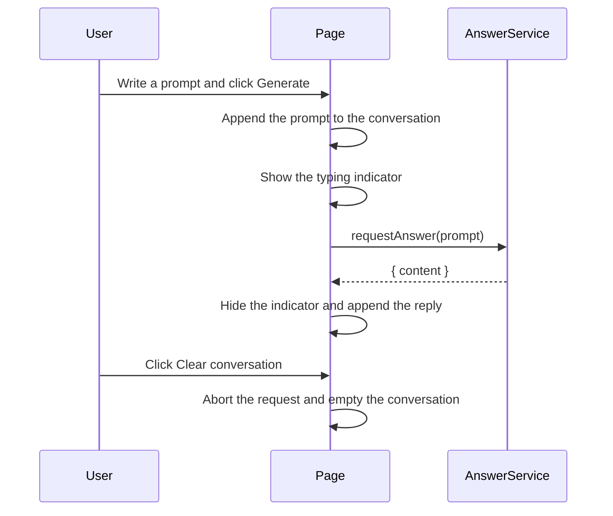

# Question and answer conversation

## Purpose

Let a person type a question or any sentence and see a model reply in the same page. The screen has a "You" field and a Generate action.

## Scope

- A composer for the current prompt.
- A conversation container that keeps each user turn and each reply.
- A typing indicator while the answer request is in flight.
- A Clear conversation action that removes everything inside that container and cancels a pending reply.
- A mock answer service that stands in for the future HTTP endpoint.

## Response contract

The UI only reads `content` from the service result:

```json
{
  "content": ""
}
```

`src/services/answerService.ts` exports `mockAnswerResponse` with that shape and `requestAnswer`, which waits briefly and then returns `{ content }`. If `mockAnswerResponse.content` is non-empty, that string is used as the reply. The steps to replace the mock with the real endpoint are in [answer-endpoint.md](./answer-endpoint.md).

## Flow



## Decisions

- The composer stays above the conversation so the first screen matches the reference layout. Submitted prompts move into the conversation container.
- Enter submits the prompt. Shift+Enter inserts a new line.
- Clearing the conversation aborts the in-flight request so a late mock reply cannot reappear.
- The mock waits 1.6 seconds so the typing indicator is visible.

## Limitations

- No live model is connected. Replies come from the mock service.
- The conversation is kept in memory and disappears on refresh.
